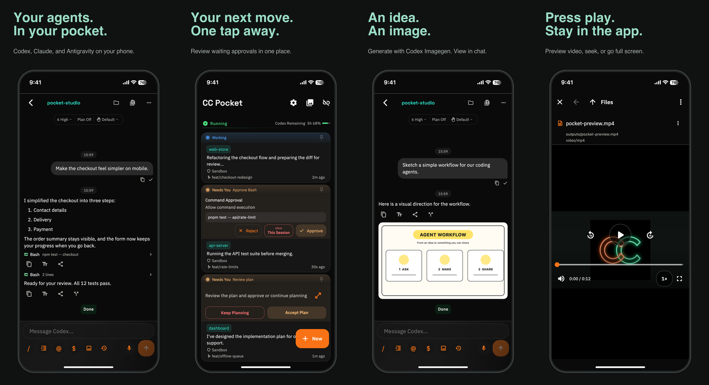

# CC Pocket

**Ajanlarınız. Cebinizde.**

Codex, Claude ve Antigravity — telefonunuz için tasarlanmış bir sohbet arayüzüyle. Bir görev başlatın, bir sonraki adımı onaylayın ve sonucu inceleyin. Aynı çalışmaya tabletinizde veya Mac'inizde devam edin.

[CC Pocket'ı keşfedin](https://k9i-0.github.io/ccpocket/install/) · Ücretsiz · Açık kaynak

[English README](README.md) | [日本語版 README](README.ja.md) | [简体中文版 README](README.zh-CN.md) | [한국어 README](README.ko.md)

<p align="center">
  
</p>

## Kurulum

1. Oturumlarınızı çalıştıracak makineye en az bir ajan CLI'ı kurun:
   [Codex](https://github.com/openai/codex), [Claude](https://docs.anthropic.com/en/docs/claude-code) veya
   [Antigravity](https://antigravity.google/product/antigravity-cli).
2. Aynı makineye [Node.js](https://nodejs.org/) 22.19.0 veya daha yeni bir sürümünü kurun.
3. CC Pocket Bridge Server'ı başlatın:

```bash
npx @ccpocket/bridge@latest
```

4. CC Pocket'ı kurun ve Bridge Server'ın yazdırdığı QR kodunu tarayın.
5. Bir proje seçin; Codex, Claude veya Antigravity'yi seçin ve uygulamadan kodlamaya başlayın.

| Platform | Kurulum |
|----------|---------|
| **iOS / iPadOS** | <a href="https://apps.apple.com/us/app/cc-pocket-code-anywhere/id6759188790"></a> |
| **Android** | <a href="https://play.google.com/store/apps/details?id=com.k9i.ccpocket"></a> |
| **macOS** | En son `.dmg` dosyasını [GitHub Releases](https://github.com/K9i-0/ccpocket/releases?q=macos) üzerinden indirin (`macos/v*` etiketli sürümlere bakın). Ayrıca Homebrew Cask ile `brew install --cask cc-pocket` komutuyla kurabilirsiniz. Yalnızca Apple Silicon desteklenir (Intel Mac'ler için son desteklenen sürüm 1.179.0'dır). |
| **Linux (deneysel)** | En son `.tar.gz` dosyasını [GitHub Releases](https://github.com/K9i-0/ccpocket/releases?q=linux) üzerinden indirin (`linux/v*` etiketli sürümlere bakın). Alternatif olarak topluluk tarafından sürdürülen [AUR paketini](https://aur.archlinux.org/packages/cc-pocket-bin) `yay -S cc-pocket-bin` ile kurabilirsiniz. |
| **Windows (deneysel)** | En son `.zip` dosyasını [GitHub Releases](https://github.com/K9i-0/ccpocket/releases?q=windows) üzerinden indirin (`windows/v*` etiketli sürümlere bakın). |

## Ücretsiz Kullanım

CC Pocket ücretsizdir. İş akışınıza yardımcı oluyorsa uygulamada Destekçi (Supporter) olmayı düşünebilirsiniz. Destekçi satın alımları geliştirme ve yapay zekâ araç maliyetlerini karşılamaya yardımcı olur.

Mobil kodlama ajanlarına yeni misiniz? Bkz. [iPhone veya Android'den Codex nasıl çalıştırılır](https://k9i-0.github.io/ccpocket/how-to-run-codex-from-iphone-android/).

## Neler Yapabilirsiniz?

- **Önce sohbet.** Her oturum istemler, yanıtlar, onaylar ve sorular için bir odadır. Markdown, sesli giriş ve görsel ekleri mobilde yön vermeyi kolaylaştırır.
- **Cihazlar arası devam edin.** Telefonunuzda, tabletinizde veya Mac'inizde CLI ya da uygulamadan oturumları sürdürün. Daha büyük ekranlar sohbeti, dosyaları ve Git değişikliklerini yan yana gösterir.
- **Zayıf ağlarda yerinizi koruyun.** Giden mesajlar siz çevrimdışıyken bekler ve yeniden bağlandığınızda gönderilir. Kaçırılan akış güncellemeleri kurtarılır. Yeni ajan istekleri bağlantı gerektirir.
- **Medya üretin ve önizleyin.** Codex Imagegen ile görseller üretin, sonuçları sohbette açın ve uygulama içinde video veya ses dosyalarını oynatın.
- **İnceleyin ve yayımlayın.** Dosyalara göz atın, kod ve görsel farklarını (diff) inceleyin; değişiklikleri sahneleyin, commit atın, gönderin veya geri alın. Paralel görevleri ayırmak için git worktree kullanın.
- **Kendi makinelerinizi kullanın.** Ajanlar Bridge Server üzerinden Mac, Linux veya Windows bilgisayarınızda çalışır. QR kodu, kayıtlı sunucu veya Tailscale ile bağlanın; Bridge'i SSH üzerinden yönetin.

## Neden CC Pocket'ı Forklamalısınız?

CC Pocket MIT lisanslıdır; bu sayede onu yalnızca bitmiş bir uygulama olarak değil, kendi ajan iş akışınız için bir başlangıç noktası olarak da kullanabilirsiniz.

- Codex, Claude veya Antigravity'yi ekibinizin Jira, Linear, GitHub veya özel REST API'leriyle birleştiren kurum içi bir istemci oluşturun.
- İhtiyacınız olmayan yüzeyleri kaldırın ve günlük iş akışınız için odaklı bir uygulama tutun.
- Sıfırdan yazmak yerine Bridge eşitleme katmanını, onay akışını, istem geçmişini, git işlemlerini, dosya taramayı ve görsel/fark görüntüleyicilerini yeniden kullanın.
- Yerel ajan araçları ve oturum geçmişleriyle uyumluluğu korurken istemlerden veya MCP'den daha kolay kullanılan iş akışına özel grafik arayüz özellikleri ekleyin.
- Masaüstü desteğini genişletin. macOS, Linux ve Windows derlemeleri bugün mevcuttur; Linux ve Windows, proje bu ortamlar için aynı sürekli doğrulama kapsamına sahip olmadığı için deneysel kalmaktadır.

Daha derin bir uygulama özeti için [teknik yığın sayfasına](https://k9i-0.github.io/ccpocket/architecture/) veya [ajanların okuyabileceği Markdown belgesine](https://k9i-0.github.io/ccpocket/architecture/stack.md) bakın.

## Nasıl Çalışır?

CC Pocket iki parçadan oluşur:

```text
CC Pocket uygulaması  <->  Makinenizdeki Bridge Server  <->  Codex / Claude / Antigravity
```

Uygulama sizin kullandığınız arayüzdür. Bridge Server projelerinize, kabuğa, git deposuna ve ajan CLI'ına erişimi olan makinede yerel olarak çalışır. Kodunuz barındırılan bir IDE'ye taşınmak yerine kendi makinenizde kalır.

## Uzaktan Erişim

Aynı ağda QR kodu veya manuel `ws://` / `wss://` URL'si ile bağlanın.

Ev veya ofis dışından erişim için önerilen kurulum Tailscale'dir:

1. Ana makinenize ve telefonunuza [Tailscale](https://tailscale.com/) kurun.
2. Aynı tailnet'e katılın.
3. CC Pocket içinden `ws://<host-tailscale-ip>:8765` adresine bağlanın.

Sürekli açık bir ana makine için Bridge Server arka plan servisi olarak da kaydedilebilir:

```bash
npx @ccpocket/bridge@1 setup
```

Servis kurulumu macOS `launchd` ve Linux `systemd` destekler.
macOS'ta Mac uyku moduna geçtiğinde Bridge çevrimdışı olur. Boşta uykuyu önlemek için Sistem Ayarları > Pil > Seçenekler altında "Ekran kapalıyken güç adaptöründe otomatik uykuyu engelle" ayarını açın (veya `caffeinate -s` çalıştırın). MacBook kapağını kapatmak, kapalı ekran kipinde (güç, harici ekran, klavye ve fare) çalışmadığı sürece cihazı yine uyutur. `doctor` komutu mevcut uyku ayarlarını raporlar.
Bridge bayrakları ve `BRIDGE_ALLOWED_DIRS` gibi kalıcı servis ayarları için [Bridge paketi README](packages/bridge/README.md#configuration) belgesine bakın.

## Notlar

- Claude oturumları varsayılan olarak `ANTHROPIC_API_KEY` kullanır. Abonelik kimlik doğrulaması, Anthropic'in mevcut resmî yönergeleri bu mimari için net bir kapsam belirtmediğinden `BRIDGE_ALLOW_CLAUDE_OAUTH=1` ile açık Bridge onayı gerektirir. Bkz. [Claude kimlik doğrulama sorun giderme](docs/auth-troubleshooting.md).
- Antigravity oturumları varsayılan olarak `agy` CLI tarafından saklanan Google girişini kullanır; bu nedenle Bridge makinesinde bir kez `agy` çalıştırarak giriş yapın. CC Pocket değiştirilmemiş CLI'ı çalıştırır ve her istemi siz yazarsınız; bunun yerine bir Gemini API anahtarı da kullanılabilir. `agy` bunları sunmadığı için geri sarma, çatallama (fork), mesaj düzenleme ve maliyet gösterimi mevcut değildir. Bkz. [Bridge notları](https://github.com/K9i-0/ccpocket/blob/main/packages/bridge/README.md#antigravity).
- CC Pocket kendi sunucunuzda barındırma ve minimum veri toplama üzerine tasarlanmıştır. Destekçi satın alımları aynı Apple ID veya Google hesabı içinde geri yüklenir, ancak mağazalar arasında eşitlenmez. Bkz. [Destekçi / Satın Alımlar](docs/supporter.md).
- macOS'ta ekran görüntüsü yakalamak, Bridge Server'ı çalıştıran terminal uygulaması için Ekran Kaydı izni gerektirir.
- CC Pocket; Anthropic, OpenAI veya Google ile bağlantılı, onlar tarafından onaylı veya ilişkili değildir.

## Geliştirme

```bash
git clone https://github.com/K9i-0/ccpocket.git
cd ccpocket
npm install
cd apps/mobile && flutter pub get && cd ../..
```

Yaygın komutlar:

| Komut | Açıklama |
|---------|-------------|
| `npm run bridge` | Bridge Server'ı geliştirme kipinde başlat |
| `npm run bridge:build` | Bridge Server'ı derle |
| `npm run dev` | Bridge'i yeniden başlat ve Flutter uygulamasını aç |
| `npm run test:bridge` | Bridge Server testlerini çalıştır |
| `cd apps/mobile && flutter test` | Flutter testlerini çalıştır |
| `cd apps/mobile && dart analyze` | Dart statik analizini çalıştır |

PR göndermeden önce gereken kurulum ve kontroller için [PR öncesi kontroller](docs/development-testing.md#before-opening-a-pr) belgesine bakın.
Yerel Bridge ve mobil uygulamayla uçtan uca kontroller için [Geliştirme Testleri](docs/development-testing.md) belgesine bakın.

Katkı yönergeleri için [CONTRIBUTING.md](CONTRIBUTING.md) dosyasına bakın.

## Lisans

[MIT](LICENSE)

Bir test düzeneği farklı bir lisans altındadır: `packages/markdown_kit/test/commonmark_spec/spec.json` dosyasındaki CommonMark spesifikasyon örnekleri CC BY-SA 4.0 lisanslıdır. Bkz. [packages/markdown_kit/NOTICE.md](packages/markdown_kit/NOTICE.md).
