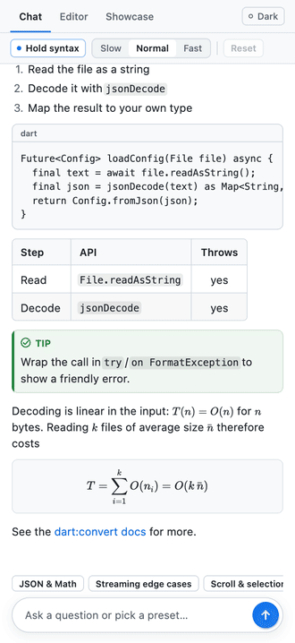
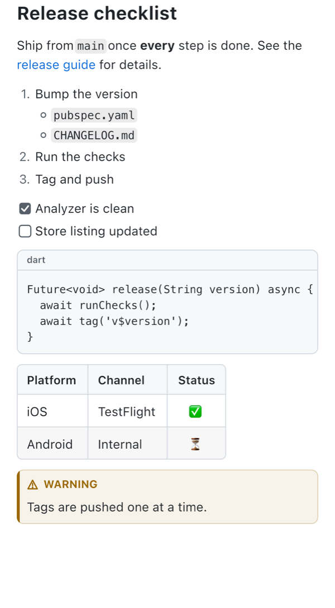
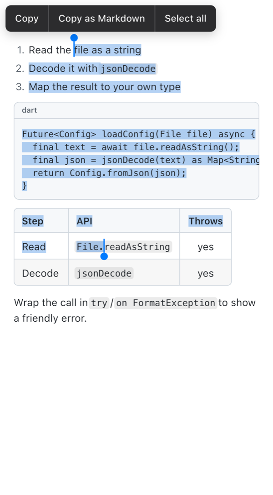
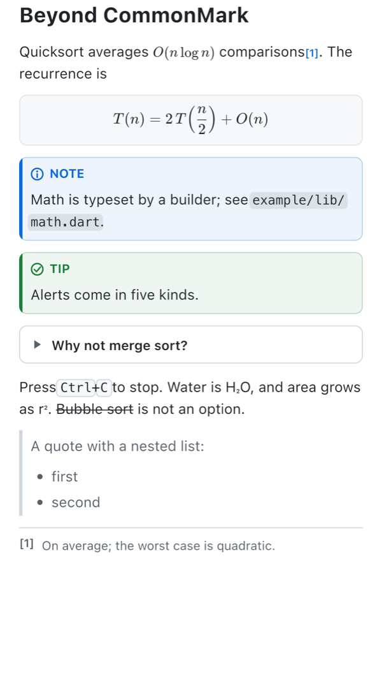
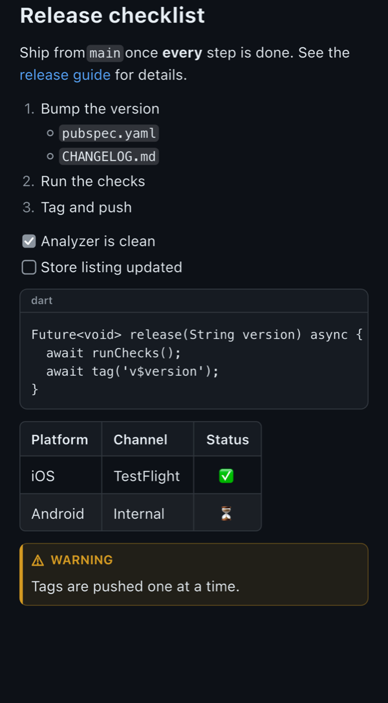
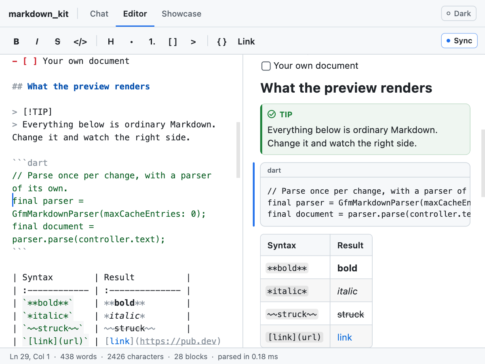

# markdown_kit

Markdown for AI chat in Flutter: text that arrives token by token, in a
scrolling list, that people still want to select and copy.

<p align="center">
  
</p>

<table>
  <tr>
    <td align="center" valign="top"></td>
    <td align="center" valign="top"></td>
    <td align="center" valign="top"></td>
    <td align="center" valign="top"></td>
  </tr>
  <tr>
    <td align="center">Blocks &amp; built-in theme</td>
    <td align="center">Selection across blocks</td>
    <td align="center">Math, alerts &amp; details</td>
    <td align="center">Built-in dark theme</td>
  </tr>
</table>

Most Markdown widgets are built for a finished document. A chat with an agent
is different, and that is where they hurt:

- **The reply is still being written.** Re-parsing and rebuilding everything
  on each token wastes work on long answers, and half-typed syntax flashes as
  raw `**`, backticks and pipes. Here finished blocks are parsed and built
  once, and unfinished bold, links, code, tables and fences are held back
  until they are complete.
- **Selection has to survive.** With widget-based selection the highlight is
  lost when a message scrolls out of a lazy list or its text updates. Here the
  selection is anchored in the document, so it stays through scrolling,
  rebuilds and streaming.
- **Fingers are imprecise.** Dragging a selection handle should not scroll the
  list behind it or trigger the back swipe. Handles here have an opaque 44pt
  hit area, and dragging one to the edge scrolls the list for you.
- **People copy from answers.** Copy gives clean text without bullet glyphs or
  code block headers, or the Markdown structure when you want it.

It is built on `package:flutter/widgets.dart` only (no Material or Cupertino
import), so colours, text styles, handles, the context menu and every block
can be replaced.

It was written for [CC Pocket](https://github.com/K9i-0/ccpocket), a mobile
client for coding agents, and renders every message there. CC Pocket has
shipped continuously since January 2026, most of that time on other Markdown
widgets. What is held back while streaming, how a selection behaves in a lazy
list, what Copy returns and how large a handle has to be were each decided by
a problem met in that app.

## When to use something else

- **You are rendering HTML documents.** Like most Markdown widgets for
  Flutter, this one does not lay out HTML. It maps a short list of tags onto
  its own nodes (see [Behaviour worth knowing](#behaviour-worth-knowing)) and
  shows the rest as text, so layout tags such as `<div>` and `<span>` stay
  as written. The list was chosen from what agents emit inside Markdown.
  For HTML itself use an HTML widget such as
  [flutter_widget_from_html](https://pub.dev/packages/flutter_widget_from_html);
  for Markdown with a much longer tag list,
  [gpt_markdown](https://pub.dev/packages/gpt_markdown).
- **You want math typeset with no extra code.** `\(…\)` and `\[…\]` are
  parsed and handed to a builder, and the package ships no typesetter. The
  example adds one with
  [flutter_math_fork](https://pub.dev/packages/flutter_math_fork) in a single
  file you can copy, [`example/lib/math.dart`](example/lib/math.dart); CC
  Pocket renders math the same way.
- **You are on Flutter older than 3.50.**

## Requirements

- Flutter 3.50 or later (Dart 3.14). Older versions are not supported: the
  test suite fails on Flutter 3.47.
- An `Overlay` above the Markdown, which every `Navigator` (and so every
  `WidgetsApp`, `MaterialApp` or `CupertinoApp` with a `home` or routes)
  provides. Selection handles and the context menu are drawn in it.

## A chat screen

One `MarkdownSelectionScope` above the list, one `MarkdownView` per reply:

```dart
final controller = MarkdownSelectionController(
  // A chat usually wants a selection to stay inside one message.
  allowCrossDocumentSelection: false,
);

MarkdownSelectionScope(
  controller: controller,
  child: ListView.builder(
    reverse: true,
    itemCount: messages.length,
    itemBuilder: (context, index) {
      final message = messages[messages.length - 1 - index];
      return MarkdownView(
        data: message.text,
        // Only the block still being written is re-parsed and rebuilt.
        isStreaming: message.isStreaming,
        // A stable id lets the selection survive the item scrolling away
        // and the switch from streaming to finished.
        documentId: message.id,
        documentOrder: index,
        builders: MarkdownBuilders(
          onLinkTap: (url, title) {
            // Open the link.
          },
        ),
      );
    },
  ),
)
```

- Every `MarkdownView`, `SliverMarkdownView` and `SelectablePlainText` below
  the scope joins the same selection. Use `SelectablePlainText` for the
  user's own messages.
- While `isStreaming` is true, syntax that is still missing its closing half
  is not shown. When the reply is finished, pass `isStreaming: false` and the
  whole text is rendered.
- Dispose the controller when the screen goes away. It keeps the parsed
  document of every view it has seen (unless that view sets
  `keepDocumentOnDispose: false`), which is what lets a selection reach text
  that has scrolled out of a lazy list.

A runnable demo with three tabs — streaming **Chat**, live-preview **Editor**,
and a **Showcase** using `SliverMarkdownView` — lives in [`example/`](example).
Try it in a browser at <https://k9i-0.github.io/markdown_kit/>.
It includes a `web/` target so it can be run directly in a browser
(`cd example && flutter run -d chrome`) or built for static hosting
(`flutter build web --release`). For mobile or desktop targets, run
`flutter create .` inside `example/` once.

Outside a chat, `MarkdownView(data: text)` on its own is enough: without a
scope above it, it manages selection for that one document.

## Going further

### One long document

Inside a `CustomScrollView`, `SliverMarkdownView` builds only the blocks near
the viewport while the whole document stays selectable. It needs a
`MarkdownSelectionScope` above the scroll view.

### An editor with a live preview

The package renders Markdown and does not edit it. What it gives an editor is
a preview that keeps up with typing, and a way to tell which block came from
which part of the source.

<p align="center">
  
</p>

```dart
// One parser for the editor. Every keystroke is a new text and none of them
// comes back, so the cache of whole documents is off.
final parser = GfmMarkdownParser(maxCacheEntries: 0);

final document = parser.parse(controller.text);

MarkdownView(
  document: document,
  builders: builders, // the same instance on every build
  blockWrapper: wrapBlock, // (index, block, child) => a widget around child
)
```

- Only the block being typed in is parsed and built again. A block added or
  removed in the middle keeps the state and layout of the blocks after it.
- `document.blockSourceRanges[i]` is the stretch of source block `i` came
  from, and `document.blockIndexAtSourceOffset(caret)` the block a position is
  in. Blocks with no blank line between them share a range.
- `blockWrapper` wraps the widget of each top-level block, which is enough to
  find a block on screen, scroll to it, or mark the one being edited.

[`example/lib/editor.dart`](example/lib/editor.dart) puts these together:
source and preview side by side that scroll in step, a marker on the block the
caret is in, and a tap on a block that jumps to its source. Run it with
`flutter run -t lib/editor.dart`.

The source pane of that example is a plain Flutter text field, and in a long
document it is what a keystroke costs: a text field lays out all of its text
again on every change. On a 24 KB document a keystroke took 9 ms in a profile
build on a Mac, 6 ms of it in the text field and under 1 ms in the parser.

### Appearance

```dart
MarkdownTheme(
  data: MarkdownThemeData.dark().copyWith(
    bodyStyle: const TextStyle(fontSize: 16, height: 1.5),
  ),
  child: child,
)
```

`MarkdownThemeData` has a style object for each construct (code blocks, inline
code, quotes, alerts, tables, details, footnotes, math) and compares by value,
so an unchanged theme never rebuilds anything.

### Extension points

`MarkdownBuilders` replaces individual pieces:

| Builder | Replaces |
| --- | --- |
| `codeHighlighter` | The spans of a code block. Return spans whose text equals the code. |
| `codeBlockBuilder` | The frame around a code block (header, copy button). |
| `inlineCodeBuilder`, `inlineLinkBuilder`, `customInlineBuilder` | Inline spans. |
| `imageBuilder` | Images. The default loads `http(s)` URLs and shows a chip for anything else. |
| `tableBuilder`, `alertBuilder` | Those blocks. |
| `blockLatexBuilder`, `inlineLatexBuilder` | LaTeX math. Return `null` to keep the built-in Unicode rendering, for example for a formula your typesetter rejects. |
| `onLinkTap` | What a tap on a link does. Without it links are not tappable. |

Math is not typeset: `\(…\)` and `\[…\]` are parsed and shown as readable text
until you supply the LaTeX builders with a renderer of your choice. The package
does not depend on one. The example wires
[flutter_math_fork](https://pub.dev/packages/flutter_math_fork) into both
builders in [`example/lib/math.dart`](example/lib/math.dart), including the two
things that integration needs: one parsed tree per formula, and a dry baseline
for formulas inside tables. `$…$` is opt-in
(`MarkdownParserOptions(enableDollarLatex: true)`) because prose about prices
would otherwise turn into formulas.

To recognise your own inline syntax (file paths, mentions, issue numbers),
subclass `MarkdownInlineRule`, pass it in `MarkdownParserOptions.inlineRules`,
and render the resulting `CustomInline` in `customInlineBuilder`.

### Context menu

With no `contextMenuBuilder`, a small built-in menu offers Copy, Copy as
Markdown and Select all (`MarkdownDefaultContextMenu`; its labels can be
translated). To show the platform's menu instead, build it in
`contextMenuBuilder` from the `MarkdownSelectionScopeState` you are given
(`contextMenuAnchors`, `copySelection()`, `selectAll()`, …).

On desktop, selection also works with the mouse and keyboard: drag,
double-click for a word, triple-click for a block, Shift+arrows, and the
platform's copy and select-all shortcuts.

## Behaviour worth knowing

- **Raw HTML is shown as text**, except `<br>`, `<b>`/`<strong>`,
  `<i>`/`<em>`, `<u>`, `<s>`/`<del>`, `<sub>`, `<sup>`, `<kbd>`, `<a>`,
  `` and `<details>`/`<summary>`. HTML comments are hidden.
- **Copy as Markdown** rebuilds Markdown from the parsed document. Fully
  selected blocks keep their structure; a partly selected first or last block
  is copied as plain text. Literal characters are not re-escaped, and math is
  written with `$` delimiters.
- **A collapsed `<details>`** still belongs to the document: a selection that
  spans it copies its hidden body too.
- **While text is streaming**, unfinished syntax is held only on the last
  line and only within 300 characters of the end; an opener further back is
  shown as plain text.
- **When a document is replaced by different text** (not just appended to),
  the selection is carried over by looking for the same words nearby. If they
  were removed and occur elsewhere, the selection moves there.
- **Nesting** deeper than 500 levels is shown as text.
- **`<sub>` and `<sup>`** rely on the font's OpenType features; with a font
  that lacks them the text is only made smaller.

The parser builds on [`package:markdown`](https://pub.dev/packages/markdown).
A few inputs make it throw; `markdown_kit` then shows just that part of the
text unparsed rather than failing. `test/commonmark_spec/baseline.json` lists
every CommonMark example where the output differs from the specification, and
why.

## How it is tested

About 1,900 tests cover the parser, streaming, rendering and selection,
including right-to-left text, large text scales and hostile input. The 652
examples of the CommonMark specification run in CI: 573 match, and
`test/commonmark_spec/baseline.json` lists every one that differs and why
(mostly raw HTML, which is shown as text by design).

## Used in

[CC Pocket](https://github.com/K9i-0/ccpocket) is the app this package was
built for. It runs on iOS, Android, macOS, Linux and Windows, and renders
every chat message, plan and file preview with it. Its
[adapter layer](https://github.com/K9i-0/ccpocket/blob/main/apps/mobile/lib/widgets/markdown/ccpocket_markdown.dart)
is a full-size example of wiring the package into a Material app: theme
mapping, the platform's selection toolbar, syntax highlighting, tappable file
paths and image handling.

## Platforms

The package has no platform-specific code. Its tests run on Linux in CI, and
the example app builds and runs on the web (`example/web/`).

## License

MIT. One test fixture is licensed differently; see [NOTICE.md](NOTICE.md).
